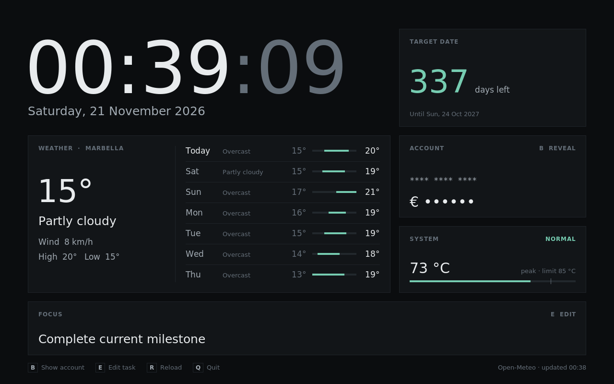
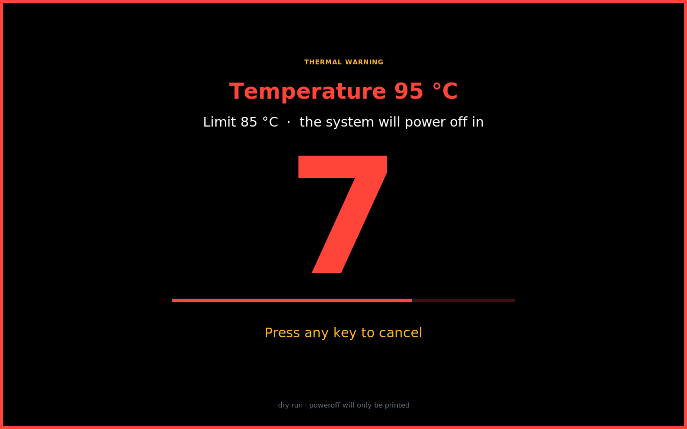

# t410dash

A fullscreen kiosk dashboard for old laptops, written in plain C99 with Xlib and Xft.
No toolkit, no browser, no runtime. Built for a ThinkPad T410i running Alpine Linux
and Openbox, with a complete, repeatable install script.



## Features

- **Clock.** Large 24-hour `HH:MM:SS` clock and the full date, updated every second.
- **Countdown.** Days left until a date you choose, with your own label.
- **Account panel.** Account number and balance from `config.json`. Masked on startup
  (`**** **** ****`, `€ ••••••`) and revealed with one key. The panel never uses the network.
- **Weather.** Current temperature, conditions, wind speed and a 7-day min/max forecast from
  [Open-Meteo](https://open-meteo.com/) (no API key). Refreshes every 30 minutes. The fetch runs
  in a child process, so the UI never waits on the network. When it fails, the dashboard keeps
  the last data and shows `Offline · last update HH:MM`.
- **Focus task.** One line for what you are working on. Press `e` to edit it in place. It is
  saved atomically to `config.json`.
- **Thermal failsafe.** Every 2 seconds it reads the highest temperature from
  `/sys/class/thermal` and `/sys/class/hwmon`. Above the limit, a full-screen warning counts down
  and then powers the machine off. Pressing any key cancels the countdown and snoozes it.
- **Kiosk behaviour.** Borderless fullscreen (`_NET_WM_STATE_FULLSCREEN`, `WM_CLASS t410dash`).
  The mouse cursor hides after 3 seconds without movement. The layout scales to 1280x800,
  1440x900 and other sizes.

## Memory use

| Measurement | Value |
| --- | --- |
| Dashboard RSS at 1280x800 (`VmRSS`, weather loaded, after 10 s) | **8.0 MB** (8144 kB) |
| Dashboard RSS at 1440x900 | **8.1 MB** (8252 kB) |
| Binary size (x86-64, musl, `-O2`, not stripped) | 72 KB |

Measured on Alpine 3.24 (x86-64) under Xvfb. See [Measuring memory](#measuring-memory).

The target is under 15 MB resident. Most of that is the Xlib, Xft, FreeType and fontconfig
shared libraries. The back buffer pixmap lives in the X server, not in the dashboard.

## Hotkeys

| Key | Action |
| --- | --- |
| `b` | Show or hide the account panel (configurable: `bank.toggle_key`) |
| `e` | Edit the focus task. `Enter` saves, `Esc` cancels, `Backspace` deletes |
| `r` | Reload `config.json` and refresh the weather now |
| `q` | Quit. Ignored while the thermal countdown is running |
| any key | During the thermal countdown: cancel the shutdown and start the snooze |

While you edit the task, every key goes into the text field. The hotkeys do nothing until you
press `Enter` or `Esc`.

## Configuration

`config.json` is looked up in this order:

1. the path given as the first argument: `t410dash /path/to/config.json`
2. `config.json` in the same directory as the `t410dash` binary
3. `~/.config/t410dash/config.json`

If no file is found, the built-in defaults are used. The first saved task then creates
`~/.config/t410dash/config.json`. Missing fields always fall back to their defaults.

```json
{
  "bank": {
    "account_number": "ES00 0000 0000 0000 0000 0000",
    "balance_eur": "0.00",
    "toggle_key": "b"
  },
  "countdown": {
    "label": "Target Date",
    "date": "2027-10-24"
  },
  "weather": {
    "latitude": 36.51,
    "longitude": -4.88,
    "city": "Marbella"
  },
  "thermal": {
    "high_temp_c": 85,
    "shutdown_delay_sec": 10,
    "snooze_sec": 60
  },
  "task": "Complete current milestone"
}
```

| Key | Type | Default | Meaning |
| --- | --- | --- | --- |
| `bank.account_number` | string | `ES00 0000 …` | Shown when the panel is revealed |
| `bank.balance_eur` | string | `"0.00"` | Balance in euros, shown as `€ 1,234.56` |
| `bank.toggle_key` | string | `"b"` | Key that reveals or masks the panel |
| `countdown.label` | string | `"Target Date"` | Title of the countdown panel |
| `countdown.date` | string | `"2027-10-24"` | Target date, `YYYY-MM-DD`, local time |
| `weather.latitude` | number | `36.51` | Forecast location |
| `weather.longitude` | number | `-4.88` | Forecast location |
| `weather.city` | string | `"Marbella"` | Label only |
| `thermal.high_temp_c` | number | `85` | Warning starts when the peak goes above this |
| `thermal.shutdown_delay_sec` | number | `10` | Countdown length before poweroff |
| `thermal.snooze_sec` | number | `60` | How long a cancelled warning stays quiet |
| `task` | string | `"Complete current milestone"` | The focus task |

When the task is saved, the file is read again, only `task` is changed, and the result is
written to a temporary file in the same directory and then renamed over `config.json`. All other
fields, including ones the dashboard does not know about, are kept. The file mode is kept too.

## Building

Dependencies: a C99 compiler, `make`, `pkg-config`, and the development files for `libX11` and
`libXft`. The fonts are DejaVu Sans and DejaVu Sans Mono.

```sh
make
make install PREFIX=/usr/local      # installs /usr/local/bin/t410dash
```

| Distribution | Build packages |
| --- | --- |
| Alpine | `build-base pkgconf libx11-dev libxft-dev` |
| Debian / Ubuntu | `build-essential pkg-config libx11-dev libxft-dev` |
| Arch | `base-devel libx11 libxft` |

Command-line options:

```
t410dash [--dry-run] [--fake-temp-file PATH] [config.json]
```

## Installing on Alpine Linux

Start from a fresh Alpine install (`setup-alpine`, "sys" disk mode) with a working network.
Then, as root:

```sh
apk add git
git clone https://github.com/<you>/t410-dashboard.git
cd t410-dashboard
sh setup_alpine.sh
reboot
```

`setup_alpine.sh` is non-interactive and safe to run again. Before it overwrites a file, it
saves a copy as `*.bak`. It never replaces an existing kiosk `config.json`. It does this:

1. Enables the `community` repository and installs `xorg-server`, `xf86-video-intel`,
   `xf86-input-libinput`, `eudev`, `xinit`, `xset`, `openbox`, `libx11`, `libxft`, `fontconfig`,
   DejaVu fonts, `doas`, `acpid` and `ca-certificates`. It switches the device manager to udev,
   which Xorg needs for input hotplug.
2. Installs the build tools as a virtual package (`.build-deps`), builds and installs
   `/usr/local/bin/t410dash`, and then removes the build tools again.
3. Creates the user `kiosk` (groups `video`, `input`) and installs
   `~kiosk/.config/t410dash/config.json` with mode `600`.
4. Installs the Openbox config from [`deploy/`](deploy):
   - `rc.xml`: no key bindings and no desktop menus. A rule for `class="t410dash"` turns off
     decorations and turns on fullscreen.
   - `autostart`: runs `xset s off -dpms s noblank`, then starts the dashboard in a loop that
     restarts it 2 seconds after it exits.
5. Adds `/etc/doas.d/kiosk.conf` with `permit nopass kiosk as root cmd /sbin/poweroff`. That is
   the only extra right the kiosk user gets.
6. Replaces the `tty1` line in `/etc/inittab` with `tty1::respawn:/bin/login -f kiosk`. The kiosk
   user's `~/.profile` runs `startx` only on `tty1` and only if `$DISPLAY` is empty. `tty2` to
   `tty6` keep their normal login prompt (`Ctrl+Alt+F2`) for maintenance.
7. Installs `/etc/acpi/handler.sh` so that closing the lid and AC or battery events do nothing.
   The power button still powers off cleanly. It enables `acpid` in the default runlevel.
8. Turns off console blanking with `/etc/local.d/consoleblank.start` (the `local` service).

Alpine has no systemd-logind, so there is no `HandleLidSwitch` to configure. Without logind or
elogind, nothing suspends the machine unless an ACPI handler tells it to, and the handler above
never does. To keep the boot console from blanking before the local service runs, add
`consoleblank=0` to `default_kernel_opts` in `/etc/update-extlinux.conf` and run
`update-extlinux`.

## Testing the thermal failsafe safely

You never need a hot CPU or a real poweroff to test the failsafe:

```sh
echo 40 > /tmp/fake-temp                       # degrees C (millidegrees also work)
t410dash --dry-run --fake-temp-file /tmp/fake-temp ./config.json &

echo 95 > /tmp/fake-temp                       # the warning appears within 2 s
# Wait for 0: stdout shows "DRY RUN: would execute: doas /sbin/poweroff".
# Or press any key: the warning closes, an amber high-temperature bar stays at the top
# and the warning comes back after snooze_sec if it is still too hot.

echo 50 > /tmp/fake-temp                       # the indicator clears
```

- `--dry-run` (or `T410DASH_DRY_RUN=1`) prints the poweroff instead of running it. After it
  prints, the dashboard behaves as if the warning had been snoozed, so you can keep testing.
- `--fake-temp-file PATH` (or `T410DASH_FAKE_TEMP=PATH`) reads the temperature from `PATH`
  instead of sysfs.



## Measuring memory

```sh
t410dash ./config.json &
sleep 10
grep VmRSS /proc/$!/status
```

## Security

- The account number and balance are only read from `config.json` and drawn on screen. They are
  never sent anywhere. The only network request the dashboard makes is the Open-Meteo forecast
  for the configured coordinates.
- Keep the config private: `chmod 600 ~/.config/t410dash/config.json`. The install script sets
  this, and saving the task keeps the existing file mode.
- The panel is masked at every start. Anyone at the screen can still press the toggle key, so
  this is a privacy screen, not access control.
- The kiosk user can run exactly one privileged command: `doas /sbin/poweroff`.

## Project layout

```
src/main.c        X11 window, drawing, event loop, hotkeys
src/config.c      config.json lookup, loading, atomic task save
src/json.c        small JSON parser and pretty-printer
src/weather.c     Open-Meteo fetch in a child process, WMO code names
src/thermal.c     sysfs temperature scan and failsafe state machine
deploy/           Openbox, session, doas, ACPI and console files used by setup_alpine.sh
setup_alpine.sh   Alpine Linux kiosk installer
```

## License

MIT, see [LICENSE](LICENSE).

---

Built with AI assistance.
